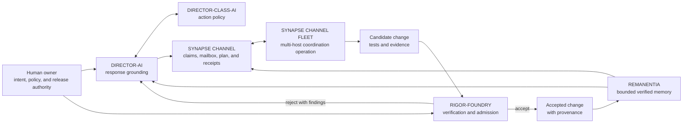

<!--
SPDX-License-Identifier: AGPL-3.0-or-later
Commercial license available
© Concepts 1996–2026 Miroslav Šotek. All rights reserved.
© Code 2020–2026 Miroslav Šotek. All rights reserved.
ORCID: 0009-0009-3560-0851
Contact: www.anulum.li | protoscience@anulum.li
SYNAPSE CHANNEL — roadmap
-->

# Roadmap

This roadmap describes direction, not promises. The authoritative record of
released changes is [`CHANGELOG.md`](CHANGELOG.md); the
[API and wire stability contract](docs/api-stability.md) defines which current
surfaces integrators may rely on.

## How to read this roadmap

SYNAPSE CHANNEL is still in its pre-1.0 line. Features below are labelled by
their real maturity:

- **Shipped** means the implementation, CLI or adapter, documentation, and
  repository tests exist in the current open-source package tree.
- **Experimental** means a working shipped surface is intentionally outside the
  stable pre-1.0 contract.
- **Active priority** means hardening or validation work, not a delivery date.
- **Research candidate** means no commitment to ship; it must earn its
  complexity and evidence.

## Ecosystem direction: a governed AI development loop

SYNAPSE CHANNEL is one component of a broader local-first development system.
The long-term direction connects six independently bounded products into a
continuous evidence loop:

The intended responsibilities are deliberately separate:

- Configured owner/agent orchestration supplies work decomposition and routing.
  **DIRECTOR-AI** checks response grounding;
  **DIRECTOR-CLASS-AI** supplies action-policy control.
- **SYNAPSE CHANNEL** coordinates identities, claims, tasks, handoffs, and
  receipts; **SYNAPSE CHANNEL FLEET** extends that coordination across seats,
  hosts, and model providers.
- **RIGOR-FOUNDRY** admits or rejects candidate changes against explicit,
  reproducible gates. A model's confidence is not admission evidence.
- **REMANENTIA** preserves bounded, attributable context with separate verification
  requirements so later
  cycles can learn without treating every generated output as truth.
- The **human owner** retains policy, release, and irreversible authority.

The target is **self-evolving, never self-authorising**: agents may propose,
implement, challenge, and improve the system, while independent roles and
fail-closed evidence gates decide what becomes durable state. "Slop-free" is an
engineering objective measured through provenance, review separation,
reproducible tests, and explicit admission criteria—not an absolute claim that
automation cannot fail.

This diagram states an ecosystem direction, not a shipped cross-project
contract. Each product's own roadmap remains authoritative for its current
interfaces, maturity, and release commitments.

## Shipped foundation

### Coordination, durability, and recovery

- File- and worktree-scoped **work claims** with overlap detection, expiring
  leases, epochs, optimistic-concurrency versions, staged-claim enforcement,
  Git hooks, and provider edit guards. See
  [Git-native claims](docs/git-claims.md).
- Contract conflicts between branches that share no file: each dependent of a
  declared contract records the spec digest it was built from, and
  `synapse contracts check` reports a stale dependent or a spec change whose
  dependents were not regenerated. The check is advisory and claims or blocks
  nothing. See [contract conflicts](docs/contract-conflicts.md).
- A typed task lifecycle and dependency-aware blackboard, append-only progress,
  atomic handoff, stalled-task supervision, resumable checkpoints, deadlock
  detection, and release receipts.
- A SQLite WAL event journal with admitted retained replay, supported idempotency keys,
  reconnect cursors, bounded histories and buffers, archive/compaction tools,
  and optional SQLCipher protection for the live store. See
  [at-rest encryption](docs/at-rest-encryption.md).
- Identity-scoped mailbox, waiter, tmux, shell-hook, and worker-session
  ergonomics for keeping provider processes reachable without making presence
  itself a wake loop.
- Mail that no session will collect can be found, handed to a successor or
  closed (`synapse mailbox orphans`, `handover`, `close` and `drain`, and
  `synapse doctor --mailbox-orphans`), and mail addressed to a role waits in
  the role's own mailbox. See the [CLI reference](docs/cli.md).
- Work state that a receiver can check, never authority: `synapse work-state
  build` pins input files by SHA-256 and repositories by commit. Uncertain
  wakes are brought to an operational end with `synapse waker uncertain`. See
  the [coordination model](docs/coordination-model.md) and
  [wake relay](docs/wake-relay.md).
- Recovery evidence: `synapse demo --recovery` runs one reproducible recovery
  story on a real local hub, and the [delivery matrix](docs/delivery-matrix.md)
  lists every request type a hub accepts with its delivery and retry key,
  backed by a whole-hub `kill -9` test.

### Agent, protocol, and editor integrations

- An optional **MCP server** over stdio or
  [authenticated private HTTPS](docs/mcp-http.md) and a fail-closed outbound MCP client
  path, while the hub and core install remain MCP-agnostic. See the
  [MCP guide](docs/mcp.md).
- An **A2A Agent Card and HTTP+JSON bridge** with a published local support
  matrix and reproducible validation receipts. This is partial validation, not
  external A2A certification. See
  [A2A conformance](docs/a2a-conformance.md).
- An `interop` workflow that drives the official MCP and A2A client libraries
  against real `synapse hub`, `synapse mcp` and `synapse a2a-serve` processes
  and judges each journey by the hub's own journal. See the
  [official-client interop lane](docs/interop.md). The
  [protocol conformance tests](docs/protocol-conformance-tests.md) page names
  the test behind each protocol version and feature it lists.
- An [integrator contract](docs/integrator-contract.md) that names one command
  or call for each of the six steps an integrator needs: register an executor,
  propose an operation, obtain authority, execute, follow the result, and
  recover after an unknown outcome.
- Provider-specific adapters and guarded mutation paths. The covered native
  tools of each provider are listed in
  [provider mutation claim hooks](docs/claim-guard-hooks.md); configuration
  adapters are not universal write interception.
- A pinned **OpenCode** integration plus ACP-driven real-client paths for Zed,
  JetBrains, Neovim, and Emacs. See the
  [OpenCode integration guide](docs/opencode.md).
- Official Python and JavaScript clients, a read-only Go HTTP client, Git and
  shell integrations, and editor/IDE packaging surfaces.

### Governance, evidence, and operator visibility

- Human-in-the-loop approval request/decision/status flows, policy evaluation,
  access-control and role surfaces, universal receipts, release verification,
  Merkle evidence, postmortem, reliability, accounting, and causality tools.
- **Operation records** bound to a claimed task: the live claim holder
  declares an operation and its effect (a file, a Git publication, a
  deployment or a migration) before acting, and its outcome report and
  verification records follow, each one journal event
  (`synapse operation declare`, `outcome` and `verification`).
  `synapse verify-result` checks the requested result
  itself: a file's exact SHA-256 and the change's tests, a commit on a remote
  branch, a deployment's health report, or a migration. See
  [execution outcomes](docs/execution-outcomes.md).
- Catalogue operations run end to end with `synapse ops run`, along one
  checked path: the exact target and executable fingerprint, the qualification
  gate of the named profile, the operator's grants read again just before the
  run, then an outcome record and an optional result verification. See
  [operations](docs/operations.md).
- Evidence that leaves the hub: `synapse export` writes a hub store's journal
  and AEF receipts as plain JSON Lines with a manifest. Signed tree heads
  (`synapse aef sth`) tell a complete export from a cut-off or rolled-back
  one, `synapse aef verify` checks chain continuity, and an optional hybrid
  countersignature (Ed25519 plus ML-DSA-65) covers a tree head. See
  [export](docs/export.md) and
  [verifying AEF evidence offline](docs/aef-verification.md).
- Signed, versioned policies for `policy-check` (`synapse policy sign` and
  `verify`), verdicts that turn stale when an input they read is corrected,
  compliance export, retention and report over one read-only journal
  snapshot, and a `reputation` ranking of recorded evidence for human triage.
  See the [policy engine](docs/policy-engine.md), [verdicts](docs/verdicts.md),
  [compliance](docs/compliance.md) and [reputation](docs/reputation.md).
- The running artefact names itself: `synapse --version` and `synapse doctor`
  print the source commit, the wheel digest and the declared profile. See
  [build identity](docs/build-identity.md). A generated
  [guarantee register](docs/guarantee-register.md) shows, for each
  capability, the last stage it has reached, checked against the tree.
- A dashboard and Studio projection for live claims, tasks, conflicts, security
  posture, receipts, governed operator actions, and observed peer state. See
  [Studio](docs/studio.md).
- Event-log ingestion and recall as the memory seam, rather than a second
  authoritative memory database.
- OpenTelemetry projection of causality evidence through an optional exporter;
  telemetry remains outside the core dependency set. With `--correlate`,
  `synapse causality otel` places recorded model usage, claim denials and
  operation records into the task traces. See
  [observability](docs/observability.md).
- Capability cards, signed advisory cards, directories, manifests, and
  evidence-preserving local routing. Cards and routing recommendations do not
  grant authority.

### Security and multi-host primitives

- Shared-secret connect authentication, exposure guards, bounded rate policy,
  private runtime directories, owner-only secret loading, dashboard Host
  defence, webhook egress pinning, and shared-host attack regressions.
- Rotating credentials: `synapse hub --token-set` admits connections from an
  owner-only set of identified tokens with validity windows, and can require
  expiry, cap a token's lifetime and close a session when its token ends;
  with a journal it records audit rows (`synapse token-set new`, `retire`,
  `list` and `status`). `/metrics` and `/health` take a token set of the same
  format, per-message HMAC keys come from a key set the hub reads again, and
  outbound peer tokens rotate without a restart. See
  [secure mode](docs/secure-mode.md) and
  [per-message authentication](docs/per-message-authentication.md).
- Machine-key trust-on-first-use identity pins, operator identity bundles,
  optional ACL and role enforcement, per-message authentication, signed-event
  verification primitives, mTLS contexts, and certificate-pin trust bundles.
  The packaged profile and managed key lifecycle remain narrower than the
  underlying primitives. See [identity and ACL](docs/identity-and-acl.md) and
  [signed events and mTLS](docs/signed-events-mtls.md).
- A hub can require every frame after registration to be signed by the key
  that proved the connection (`--require-signed-frames`; the Python and
  JavaScript clients sign when it is required) and refuse a name that proves
  no key (`--require-identity-proof`). Signing connections are closed once
  their key stops being trusted, and the hub journals each change in the
  roles a connection binds. See
  [per-message authentication](docs/per-message-authentication.md).
- Multi-hub observation, claim forwarding, protocol-version negotiation,
  federation bundle offer/fetch/import/rotate/revoke flows, and guarded relay
  primitives. Federation does not turn observed peer state into local
  authority. See [multi-hub sync](docs/multi-hub-sync.md) and the
  [federated trust model](docs/federated-trust-model.md). Out-of-tree
  federation consumers import from one package, `synapse_channel.federation_api`
  (see [API stability](docs/api-stability.md)).

## Shipped experimental surfaces

These surfaces work today but remain explicitly experimental until their
contracts and external evidence mature:

- A capability-limited WebAssembly tool sandbox with deny-by-default grants,
  bounded resources, approval support, and run receipts. It is not a general
  host or container isolation claim. See the
  [sandbox getting-started guide](docs/wasm-sandbox-getting-started.md).
- Declarative workflows compiled to the existing blackboard DAG, participant
  deliberation, semantic routing, adaptive TTL advice, automated-action advice,
  resource bidding, and other lab-tier analysis/governance helpers.
- Advanced federation, trust, encryption, and hardware-backed key adapters
  whose stable operator profiles are still being consolidated.
- Linux protected-execution primitives: one trusted writer API over live
  kernel checks and signed authority status, root-owned installation bytes
  retained in sealed memory files, cgroup ancestry and process-subtree
  observations, and a protected frontend control channel over native Unix
  channels. They expose observations and refuse on mismatch; they install no
  writer, supervisor or service and grant no recovery authority. See the
  [coordination specification](docs/coordination-spec.md#durable-protected-execution-evidence).

## On `main`, not yet released

These changes are on the `main` branch and in no release yet. The
"Unreleased" section of the [changelog](CHANGELOG.md) records them; they are
shipped only when a release carries them.

- The cockpit as the dashboard's front door, built into the wheel.
  `/capabilities.json` lists each optional surface and whether this start
  serves it, and `/findings.json` serves the findings agents recorded with the
  hub. See [cockpit](docs/cockpit.md).
- Attempts and seals for declared operations: `synapse operation declare
  --intent` fixes an authorisation intent before the effect,
  `synapse operation attempt` asks the hub to open an attempt for that exact
  intent, `synapse operation seal` ends an attempt whose executor fell silent,
  and `synapse verify-result git` reads an attempt's marker. See
  [execution outcomes](docs/execution-outcomes.md).
- Version 0.1 of the effect-safety suite: `synapse effect-suite run` runs
  cases 1 to 4 in twenty-one variants against this package's own stack. See
  [effect suite](docs/effect-suite.md).
- History read queries answered only to the identity they name; an inbox page
  and an owned-work listing on the MCP stdio bridge; and remote MCP mutations
  that carry their operation identifier as a tool argument, with lease fences
  that survive the adapter's restarts. See the [MCP guide](docs/mcp.md) and
  the [protocol](docs/protocol.md).

## Active pre-1.0 priorities

1. **Delivery integrity and secure outcomes.** Eliminate stale or misdirected
   wake traffic, finish outcome-oriented secure profiles, keep exposed hubs
   bounded by default, and extend replay-resistant durable trust state.
2. **A smaller golden path.** Make install → connect → claim → conflict refusal
   → handoff → verified receipt understandable without navigating the full
   advanced CLI surface.
3. **Protocol and platform evidence.** Freeze the 1.0 wire/API compatibility
   contract, exercise version-negotiation fixtures, and keep real Linux, macOS,
   and Windows filesystem semantics in CI.
4. **Operational recovery.** Exercise backup, restore, migration, corruption
   recovery, long-running soak, and measured capacity limits rather than
   inferring readiness from unit tests.
5. **External validation.** Publish reproducible successes and failures from
   independent fleets and security review. The project does not claim external
   certification, a completed pentest, or universal production suitability
   before that evidence exists.
6. **Stable boundaries.** Keep coordination core, integrations, security
   profiles, and labs visibly separated without replacing the blackboard with
   a second orchestration runtime.

The [0.x to 1.0 migration guide](docs/migration-1.0.md) records the concrete
freeze and release-cut checks.

## Research candidates

Each candidate remains optional and must arrive with a threat model, bounded
dependencies, real boundary tests, and a reversible adoption path:

- An **agent change transaction** joining a declared intent, scoped authority,
  an approval bound to that exact intent, a single application of the approval,
  and independently verifiable receipts. The intent is fixed before approval
  and checked again at the moment of use. A change whose result has a content
  address, such as a Git commit, is prepared first, approved by that address,
  and then published in one step.
- **Consistency proofs between signed tree heads**, so that two holders of
  exported evidence can detect a forked or rolled-back log offline, without the
  receipts.
- An **executor profile** that states how an executor is isolated, with a
  per-run record a verifier can check, so that an isolation level is evidence
  and not a label.
- A **runnable effect-safety test set** for agent executors: a denied operation
  leaves no effect, a changed operation is refused, a repeated delivery has one
  effect, and an unknown outcome stays unknown.
- Semantic claims beyond literal paths and Python symbols: exported APIs,
  OpenAPI operations, protobuf messages, database objects and migrations,
  Terraform resources, manifests, and CI/public contracts.
- Pre-execution read/write-set simulation and conflict-aware scheduling.
- Causal replay and counterfactual task-order analysis without exposing
  secrets.
- Per-operation, non-transferable capability tokens instead of shared mutation
  credentials.
- Managed workload identity such as OIDC or SPIFFE after demonstrated
  deployment demand.
- Broader managed end-to-end encrypted-channel profiles after identity, key
  lifecycle, recovery and metadata-leakage qualification. The existing opt-in
  chat-payload encryption remains its narrower shipped surface.

## Explicit limits and non-goals

To keep the bus inspectable and local-first, SYNAPSE CHANNEL does not aim to
be:

- an internal consensus protocol, distributed lock manager, or CRDT system;
- a standalone graph database or a second authoritative task/memory store;
- an opaque hosted control plane required for the open-source core to work;
- an autonomous authority that grants permissions from capability cards,
  routing scores, trust rankings, model output, or dashboard state;
- a claim that agents are contained merely because they coordinate through the
  bus; or
- a substitute for operating-system isolation, code review, CI, independent
  security assessment, or operator judgement.
