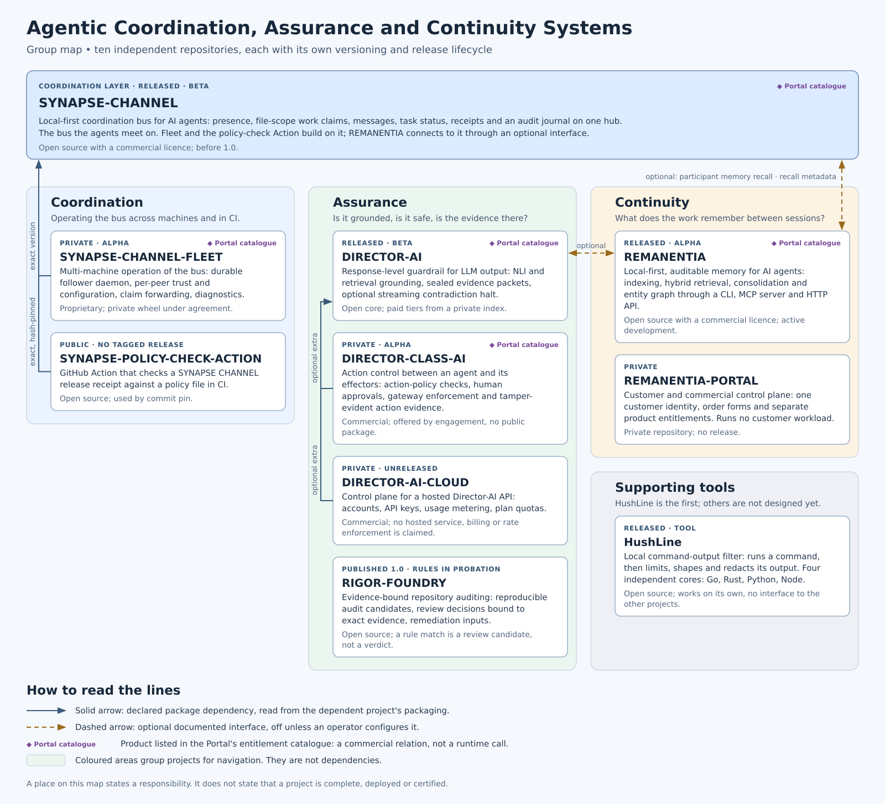

<!--
SPDX-License-Identifier: AGPL-3.0-or-later
Commercial license available
© Concepts 1996–2026 Miroslav Šotek. All rights reserved.
© Code 2020–2026 Miroslav Šotek. All rights reserved.
ORCID: 0009-0009-3560-0851
Contact: www.anulum.li | protoscience@anulum.li
SYNAPSE CHANNEL — group and project map
-->

# Group and Project Map

## What this group is for

**Agentic Coordination, Assurance and Continuity Systems** builds independent
projects for running AI agents as accountable engineering participants. Teams
use them to let several agents work on the same software without overlapping
changes, to check what an agent says and what it is about to do, and to keep
a verifiable record of what actually happened.

The group serves software and platform teams that run coding agents, security
and compliance teams, auditors and reviewers, AI product teams that need
grounded answers, and researchers working on agent memory and coordination.

The group answers three questions:

- **Coordination** — who is working on what, and who may change it?
- **Assurance** — is what an agent says grounded, is what it is about to do
  allowed, and does a repository hold the evidence it claims?
- **Continuity** — what does the work remember between sessions?

SYNAPSE CHANNEL is the coordination layer: the bus the agents meet on. This
page is the canonical map of the group.

_Last reviewed: 2026-11-06. Status describes each project's documented
delivery boundary. It is not a qualification of every feature, platform or
deployment._

## Where to start

| You want to | Start with |
| --- | --- |
| Run several AI agents in one repository without overlapping edits | [SYNAPSE-CHANNEL](https://github.com/anulum/synapse-channel) |
| Check that an LLM answer is grounded before it reaches a user | [DIRECTOR-AI](https://github.com/anulum/director-ai) |
| Audit a repository with evidence bound to each finding | [RIGOR-FOUNDRY](https://github.com/anulum/rigor-foundry) |
| Give agents memory that survives the session | [REMANENTIA](https://pypi.org/project/remanentia/) |
| Keep noisy or sensitive command output away from an agent | [HushLine](https://github.com/anulum/HushLine) |
| See how far each SYNAPSE CHANNEL capability has come | [Guarantee register](guarantee-register.md) |

## How to read status

Two things are kept apart on this page: **what a project is responsible for**
and **what it has delivered**. A place on the map states a responsibility. It
does not state that a project is complete, deployed or certified.

| Label | Meaning on this page |
| --- | --- |
| **Released** | A public package or release exists. Its maturity is the one its own package metadata declares (alpha, beta, stable). |
| **Private delivery** | The repository is private. The software is delivered under agreement, not as a public package. |
| **Unreleased** | The repository exists and is developed; no release has been made. |
| **Architecture documented** | A written design with its main interfaces exists. Implementation, qualification and release are separate milestones. |

Maturity inside a released project is a further question. For SYNAPSE
CHANNEL, the [guarantee register](guarantee-register.md) shows, per
capability, whether it is only described, implemented, wired into the running
product, qualified on a named platform, or released. A receipt for one
platform does not qualify another.

Each project has its own development, versioning and release lifecycle. No
project requires the whole group. Where two projects meet, they meet through a
declared package dependency or through an optional interface that stays off
until an operator configures it.

## Where your team fits

Choose the work your team does, then start with the projects and interfaces in
that row. A team may span several rows; each project keeps its single
responsibility owner.

| Your team | Projects to look at | What you would do | Interfaces to inspect first |
| --- | --- | --- | --- |
| Platform and developer-tools engineering | [SYNAPSE-CHANNEL](https://github.com/anulum/synapse-channel), SYNAPSE-CHANNEL-FLEET | Run several coding agents on shared repositories, on one machine or across machines. | [Coordination model](coordination-model.md), file-scope claims, [protocol](protocol.md), [MCP](mcp.md). |
| CI and release engineering | [SYNAPSE-POLICY-CHECK-ACTION](https://github.com/anulum/synapse-policy-check-action), [SYNAPSE-CHANNEL](https://github.com/anulum/synapse-channel) | Check release receipts against a policy file in CI. | [Policy engine](policy-engine.md), release receipts. |
| Security and compliance | [SYNAPSE-CHANNEL](https://github.com/anulum/synapse-channel), DIRECTOR-CLASS-AI, [HushLine](https://github.com/anulum/HushLine) | Control what agents may change, which actions need approval, and what output reaches an agent. | [Identity and ACL](identity-and-acl.md), [compliance](compliance.md), approvals, output filtering. |
| Audit and review | [RIGOR-FOUNDRY](https://github.com/anulum/rigor-foundry), [SYNAPSE-CHANNEL](https://github.com/anulum/synapse-channel) | Audit repositories and verify agent evidence offline, without trusting the tool that produced it. | Audit candidates bound to evidence, [offline AEF verification](aef-verification.md). |
| AI product and applied ML | [DIRECTOR-AI](https://github.com/anulum/director-ai), [REMANENTIA](https://pypi.org/project/remanentia/) | Check answers against sources before they reach a user; give an assistant durable memory. | Grounding and evidence packets; retrieval through CLI, MCP or HTTP API. |
| Research on agents and memory | [REMANENTIA](https://pypi.org/project/remanentia/), [SYNAPSE-CHANNEL](https://github.com/anulum/synapse-channel) | Study recall, consolidation and multi-agent coordination with reproducible records. | Memory indexing and recall; the hub's audit journal. |

## Programme connections

| Between | Interface | State |
| --- | --- | --- |
| Coordination and continuity | SYNAPSE CHANNEL can recall participant memory from REMANENTIA; REMANENTIA can mirror its recall telemetry to a hub and take findings authored on a hub into memory. | Exists in source, off until an operator configures it. |
| Assurance and continuity | DIRECTOR-AI can use REMANENTIA as a retrieval backend and send it correctness feedback; REMANENTIA can score recalled answers with DIRECTOR-AI. | Exists in source, off until an operator configures it. |
| Coordination and assurance | — | Not built. |

Today there is no interface between SYNAPSE CHANNEL and the assurance projects.
This page will list one when it exists.

## What exists today

### The coordination layer

| Repository | Function | Current status |
| --- | --- | --- |
| [SYNAPSE-CHANNEL](https://github.com/anulum/synapse-channel) | Local-first coordination bus for AI agents: presence, file-scope work claims, messages, task status, receipts and an audit journal on one hub. | **Released** on PyPI and GitHub. AGPL-3.0-or-later with a commercial licence. Beta, before 1.0. Per-capability stages are in the [guarantee register](guarantee-register.md). |

### Coordination

| Repository | Function | Current status |
| --- | --- | --- |
| SYNAPSE-CHANNEL-FLEET | Multi-machine operation of the bus: durable follower daemon, per-peer trust and configuration, claim forwarding and diagnostics. | **Private delivery** as a wheel under agreement; proprietary licence. Alpha. |
| [SYNAPSE-POLICY-CHECK-ACTION](https://github.com/anulum/synapse-policy-check-action) | GitHub Action that checks a SYNAPSE CHANNEL release receipt against a policy file in CI. | Public, AGPL-3.0-or-later. No tagged release; used by commit pin. |

The open-source core provides the federation primitives. Fleet operates them
across machines and does not redefine the core's contracts. The Action
installs one exact, hash-verified SYNAPSE CHANNEL release and runs its policy
check; the Action's own version decides which release that is.

### Assurance

| Repository | Function | Current status |
| --- | --- | --- |
| [DIRECTOR-AI](https://github.com/anulum/director-ai) | Response-level guardrail for LLM output: NLI and retrieval grounding, sealed evidence packets and an optional streaming contradiction halt. | **Released** on PyPI and GitHub. Apache-2.0 open core; advanced tiers are source-available under BUSL-1.1 with a text-and-data-mining reservation, from a private index. Beta. |
| DIRECTOR-CLASS-AI | Action control between an autonomous agent and its effectors: action-policy checks, human approvals, gateway enforcement and tamper-evident action evidence. | **Private delivery** by commercial engagement; BUSL-1.1 with a text-and-data-mining reservation. Alpha. Its benchmark evidence is local functional evidence; no deployment is claimed. |
| DIRECTOR-AI-CLOUD | Control plane for a hosted Director-AI API: accounts, API-key lifecycle, usage metering, plan quotas and operator exports. | **Unreleased**; private, BUSL-1.1 with a text-and-data-mining reservation. No production hosted service, billing or rate enforcement is claimed. |
| [RIGOR-FOUNDRY](https://github.com/anulum/rigor-foundry) | Evidence-bound repository auditing: inventories Git-tracked content, emits reproducible audit candidates, binds review decisions to exact evidence and prepares remediation inputs. | **Released** 1.0 on PyPI and GitHub; Apache-2.0. Its CLI, stable Python imports and versioned schemas have a compatibility contract; its detection rules remain in maturity probation, and its package metadata declares pre-alpha. It is not promoted as a fleet-wide audit authority. |

Director-AI answers whether an answer is grounded. Director-Class AI answers
whether an action may run. Director-AI Cloud holds the accounts and metering
of a hosted service; the open package does not depend on it. RigorFoundry
reads a repository and reports candidates with their evidence: a rule match is
input for human review, and a clean scan is not a clean-repository claim.

Director-AI's correctness feedback to REMANENTIA carries the guard's own
judgement of a recalled grounding. It is not independent truth, and a feedback
error does not stop an answer.

### Continuity

| Repository | Function | Current status |
| --- | --- | --- |
| [REMANENTIA](https://pypi.org/project/remanentia/) | Local-first, auditable memory for AI agents and knowledge-intensive software: project-file indexing, hybrid retrieval, consolidation and an entity graph, through a CLI, an MCP server and an HTTP API. | **Released** on PyPI; AGPL-3.0-or-later with a commercial licence. Alpha, in active development. |
| REMANENTIA-PORTAL | Account and billing or licence-request portal for the product family. It runs no customer workload. | **Unreleased**; private, AGPL-3.0-or-later. Self-service entitlement issuance, refunds and live billing are not claimed. |

Remanentia owns memory, recall and consolidation. The Portal owns customer
accounts and commercial requests, and no product runtime logic.

### Supporting tools

| Tool | Function | Current status |
| --- | --- | --- |
| [HushLine](https://github.com/anulum/HushLine) | Local command-output filter: runs a command, then limits, shapes and redacts its output before it reaches a caller. Four independent cores: Go, Rust, Python and Node. | **Released** on GitHub, PyPI, crates.io and npm; AGPL-3.0-or-later. Works on its own; it has no interface to the other projects. |

HushLine is the group's first supporting tool. Further tools and components
are formed and tested in the group's internal workbench and appear here once
they join the group. This page names none in advance.

## How the projects are meant to work together

_Architecture documented · not built._ This section describes the intended
direction. It is not a description of an integrated product, and no interface
listed here exists yet unless the tables above say so.

The group's direction is a **change-integrity plane around agent work**, not a
new agent platform. For a named operation it should answer: who may act, what
actually happened, what is still unknown, and how to continue safely.

| Step | Question | Intended responsibility |
| --- | --- | --- |
| 1 | Which rules apply to this work? | Rules are compiled and selected before the work starts; a missing fact refuses. |
| 2 | Who may do this, until when? | Typed, expiring permissions for one actor, action and target. |
| 3 | What will change? | The agent declares the change before it runs; a change beyond the declaration is refused. |
| 4 | Is this exact action approved? | Approval is bound to the exact action, not to a summary of it. |
| 5 | Did it run once, in a controlled place? | One fenced attempt; the executor, not the agent, holds the access. |
| 6 | What actually happened? | The effect is observed independently of the agent that caused it; without an observation the result is unknown, not success. |
| 7 | Is the result accepted? | An independent review accepts or refuses it. |
| 8 | Is the record durable and checkable? | The complete result is retained, and the evidence can be verified offline without trusting any vendor, this group included. |

Every step can stop. A stop or a withdrawn permission must reach the executor.
A receipt at any step is evidence, never permission.

## Development roadmap

No dates are announced. Each milestone is claimed only when its evidence exists.

| Milestone | Intended result | Evidence required before claiming it |
| --- | --- | --- |
| One governed change end to end | One ordinary maintenance change carried through every step above in our own environment. | The change accepted, the full record present, and the evidence verified offline. |
| Isolated execution for files and Git | Agents submit an intent; the executor holds the access. | A qualification on a named platform showing that direct access around the executor is not possible in that profile. |
| Portable evidence | A self-contained evidence bundle that a third party can verify. | An independent verifier checking the bundle without the producing software. |
| Measured value | Evidence that the system helps, against a simple baseline. | A pre-registered pilot with real tasks, a baseline and stop rules, reported whatever the result. |
| Outside pilots | Use outside our own environment. | A pilot with a control comparison and published limits. |

Ecosystems follow in order: files, Git and software development first; then
APIs, databases and cloud; then browser and desktop. Physical systems come last
and never under the same safety promise.

## Connections outside the group

Two projects of the group can use a package of another group, **SCPN Systems
Integration and Control**. Both connections are optional extras declared in
the project's own packaging; neither is installed by default, and the
schematic shows relations inside the group only.

| Project | Uses | For | Declared as |
| --- | --- | --- | --- |
| DIRECTOR-AI | `scpn-studio-platform` | The adversarial strip-resistance battery of its verifiable-honesty seal. | Optional extra `honesty`, Python 3.12 or later. |
| REMANENTIA | `scpn-studio-platform` | Signed finding envelopes. | Optional extra `seal`, Python 3.12 or later. |

A declared extra records an optional package dependency. Adapter
implementation, runtime reachability and compatibility require their own
source and execution evidence. The declaration does not qualify the two
projects together.

## How to read the schematic

[Open the full-size SVG](assets/agentic_group_map.svg),
[download PNG](assets/agentic_group_map.png), or
[download JPG](assets/agentic_group_map.jpg).

The schematic uses two kinds of line and one marker. Nothing else on it is a
relation.

| Mark | Meaning | Where |
| --- | --- | --- |
| Solid arrow | A package dependency declared in the dependent project's packaging. | SYNAPSE-CHANNEL-FLEET and SYNAPSE-POLICY-CHECK-ACTION depend on one exact SYNAPSE CHANNEL version. DIRECTOR-CLASS-AI and DIRECTOR-AI-CLOUD can use DIRECTOR-AI through an optional extra. |
| Dashed arrow | An optional, documented interface that is off until an operator configures it. | SYNAPSE CHANNEL can query REMANENTIA for participant memory recall. REMANENTIA can send recall-query and outcome telemetry, which carries the query text, to a SYNAPSE CHANNEL hub, and can take findings authored on a hub into memory. DIRECTOR-AI can use REMANENTIA as a retrieval backend for grounding and can send it correctness feedback on recalled groundings; REMANENTIA can score recalled answers with DIRECTOR-AI. |
| Portal catalogue marker | The product has an entry in the Portal's product catalogue. This is a commercial relation, not a runtime call. | SYNAPSE-CHANNEL, SYNAPSE-CHANNEL-FLEET, DIRECTOR-AI, DIRECTOR-CLASS-AI and REMANENTIA. |

A dashed arrow marks an optional adapter that exists in source. It does not
state that the two projects are jointly qualified or supported as one chain.
REMANENTIA installs its two adapters through optional extras of its own
packaging, `bus` (synapse-channel) and `guarded` (director-ai); the schematic
draws them as the dashed interfaces they serve.
The coloured areas group projects for navigation; they are not dependencies.

## Reading paths by role

| You are | Read in this order |
| --- | --- |
| Engineer running agents | [Quickstart](quickstart.md) → [coordination model](coordination-model.md) → [MCP](mcp.md) → [operations](operations.md) |
| Security reviewer | [Identity and ACL](identity-and-acl.md) → [compliance](compliance.md) → [guarantee register](guarantee-register.md) → [offline AEF verification](aef-verification.md) |
| Auditor or evaluator | [Guarantee register](guarantee-register.md) → [execution outcomes](execution-outcomes.md) → [RIGOR-FOUNDRY](https://github.com/anulum/rigor-foundry) |
| Partner or investor | [What exists today](#what-exists-today) → [where your team fits](#where-your-team-fits) → [commercial](commercial.md) |

## Abbreviations

| Term | Meaning |
| --- | --- |
| AEF | The signed, chained receipt format a SYNAPSE CHANNEL hub can write for coordination decisions (v0.1 draft). |
| AGPL | GNU Affero General Public License. |
| API | Application programming interface. |
| BUSL | Business Source License: a source-available licence with usage limits; each project's licence file gives its terms. |
| CI | Continuous integration. |
| CLI | Command-line interface. |
| LLM | Large language model. |
| MCP | Model Context Protocol, a standard way for AI clients to call tools and data sources. |
| NLI | Natural-language inference: checking whether one text supports or contradicts another. |

See the full [glossary](glossary.md) for SYNAPSE CHANNEL terms.

## Get involved

Open an issue in the repository concerned for a reproducible problem or a
concrete contribution proposal. Include the project, version, inputs and the
evidence you rely on, so the discussion reaches the right owner.

For research collaboration, commercial licensing or partnership enquiries:
[www.anulum.li](https://www.anulum.li) |
[protoscience@anulum.li](mailto:protoscience@anulum.li).

When citing SYNAPSE CHANNEL, use its
[CITATION.cff](https://github.com/anulum/synapse-channel/blob/main/CITATION.cff)
and name the release used.
