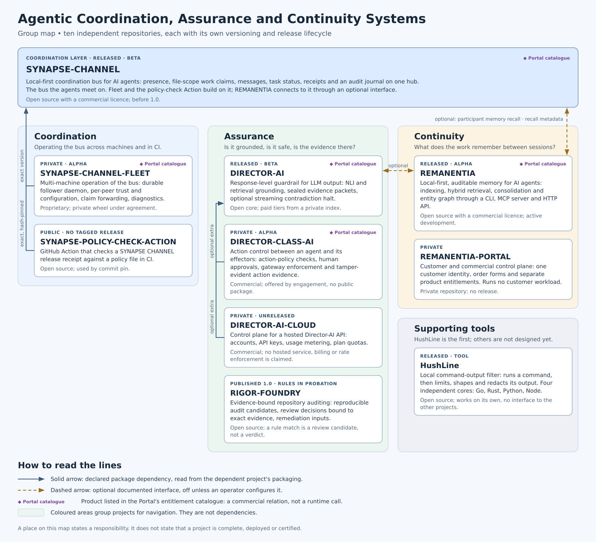

<!--
SPDX-License-Identifier: AGPL-3.0-or-later
Commercial license available
© Concepts 1996–2026 Miroslav Šotek. All rights reserved.
© Code 2020–2026 Miroslav Šotek. All rights reserved.
ORCID: 0009-0009-3560-0851
Contact: www.anulum.li | protoscience@anulum.li
SYNAPSE CHANNEL — group and project map
-->

# Group and Project Map

SYNAPSE CHANNEL belongs to **Agentic Coordination, Assurance and Continuity
Systems**, a group of independent projects for running AI agents as
accountable engineering participants. The group answers three questions:

- **Coordination** — who is working on what, and who may change it?
- **Assurance** — is what an agent says grounded, is what it is about to do
  safe, and does a repository hold the evidence it claims?
- **Continuity** — what does the work remember between sessions?

The group was defined around these three questions from the start. Its
repositories have clear responsibilities, and the connections between them
are partly in place and still forming. SYNAPSE CHANNEL is the coordination
layer: the bus the agents meet on. This page is the canonical map of the
group.

Each project has its own development, versioning and release lifecycle, and
some are not released. No project requires the whole group. Where two projects meet, they meet through a
declared package dependency or through an optional interface that stays off
until an operator configures it.

[Open the full-size SVG](assets/agentic_group_map.svg),
[download PNG](assets/agentic_group_map.png), or
[download JPG](assets/agentic_group_map.jpg).

Status on this page was recorded on 2026-10-11. Each repository's own
releases and documentation are the current record.

## Where to start

| You want to | Start with |
| --- | --- |
| Run several AI agents in one repository without overlapping edits | [SYNAPSE-CHANNEL](https://github.com/anulum/synapse-channel) |
| Check that an LLM answer is grounded before it reaches a user | [DIRECTOR-AI](https://github.com/anulum/director-ai) |
| Audit a repository with evidence bound to each finding | [RIGOR-FOUNDRY](https://github.com/anulum/rigor-foundry) |
| Give agents memory that survives the session | [REMANENTIA](https://github.com/anulum/remanentia) |
| Keep noisy or sensitive command output away from an agent | [HushLine](https://github.com/anulum/HushLine) |

## The coordination layer

| Repository | Function | Current status |
| --- | --- | --- |
| [SYNAPSE-CHANNEL](https://github.com/anulum/synapse-channel) | Local-first coordination bus for AI agents: presence, file-scope work claims, messages, task status, receipts and an audit journal on one hub. | Public, AGPL-3.0-or-later with a commercial licence. Released on PyPI and GitHub; beta maturity, before 1.0. |

One interface between SYNAPSE CHANNEL and another project of the group exists
today: optional [participant memory recall](participant-memory.md) from
REMANENTIA. Interfaces between SYNAPSE CHANNEL and the assurance projects are
not built. This page will list them when they exist.

## Coordination

| Repository | Function | Current status |
| --- | --- | --- |
| SYNAPSE-CHANNEL-FLEET | Multi-machine operation of the bus: durable follower daemon, per-peer trust and configuration, claim forwarding and diagnostics. | Private repository, proprietary licence, delivered as a private wheel under agreement. Alpha maturity; no public release. |
| [SYNAPSE-POLICY-CHECK-ACTION](https://github.com/anulum/synapse-policy-check-action) | GitHub Action that checks a SYNAPSE CHANNEL release receipt against a policy file in CI. | Public, AGPL-3.0-or-later. No tagged release; used by commit pin. |

The open-source core provides the federation primitives. Fleet operates them
across machines and does not redefine the core's contracts. The Action
installs one exact, hash-verified SYNAPSE CHANNEL release and runs its policy
check; the Action's own version decides which release that is.

## Assurance

| Repository | Function | Current status |
| --- | --- | --- |
| [DIRECTOR-AI](https://github.com/anulum/director-ai) | Response-level guardrail for LLM output: NLI and retrieval grounding, sealed evidence packets and an optional streaming contradiction halt. | Public, Apache-2.0 open core; paid tiers under BUSL-1.1 from a private index. Released on PyPI and GitHub; beta maturity. |
| DIRECTOR-CLASS-AI | Action control between an autonomous agent and its effectors: action-policy checks, human approvals, gateway enforcement and tamper-evident action evidence. | Private repository, BUSL-1.1, offered by commercial engagement. Alpha maturity; no public package. Its benchmark evidence is local functional evidence, and no deployment is claimed. |
| DIRECTOR-AI-CLOUD | Control plane for a hosted Director-AI API: accounts, API-key lifecycle, usage metering, plan quotas and operator exports. | Private repository, BUSL-1.1. Unreleased. No production hosted service, billing or rate enforcement is claimed. |
| [RIGOR-FOUNDRY](https://github.com/anulum/rigor-foundry) | Evidence-bound repository auditing: inventories Git-tracked content, emits reproducible audit candidates, binds review decisions to exact evidence and prepares remediation inputs. | Public, Apache-2.0. Published 1.0 on PyPI and GitHub. Its defined CLI, stable Python imports and versioned schemas have a compatibility contract; its detection rules remain in maturity probation, and its package metadata still declares pre-alpha. It is not promoted as a fleet-wide audit authority. |

Director-AI answers whether an answer is grounded. Director-Class AI answers
whether an action may run. Director-AI Cloud holds the accounts and metering
of a hosted service; the open package does not depend on it. RigorFoundry
reads a repository and reports candidates with their evidence: a rule match is
input for human review and a clean scan is not a clean-repository claim.

Director-AI's correctness feedback to REMANENTIA carries the guard's own
judgement of a recalled grounding. It is not independent truth, and a feedback
error does not stop an answer.

## Continuity

| Repository | Function | Current status |
| --- | --- | --- |
| [REMANENTIA](https://github.com/anulum/remanentia) | Local-first, auditable memory for AI agents: indexing of project files, hybrid retrieval, consolidation and an entity graph, through a CLI, an MCP server and an HTTP API. | Public, AGPL-3.0-or-later with a commercial licence. Released on PyPI; alpha maturity, active development. |
| REMANENTIA-PORTAL | Customer and commercial control plane for the product family: one customer identity, order forms and separate, auditable product entitlements. It runs no customer workload. | Private repository; no release. |

Remanentia owns memory, recall and consolidation. The Portal owns customer
identity, orders and entitlements, and no product runtime logic.

## Supporting tools

| Tool | Function | Current status |
| --- | --- | --- |
| [HushLine](https://github.com/anulum/HushLine) | Local command-output filter: runs a command, then limits, shapes and redacts its output before it reaches a caller. Four independent cores: Go, Rust, Python and Node. | Public, AGPL-3.0-or-later. Released on GitHub, PyPI, crates.io and npm. Works on its own; it has no interface to the other projects. |

HushLine is the group's first supporting tool. Emerging tools, and possibly
further components, are not designed yet, and this page names none. New work
is formed and tested in the group's internal workbench and appears here once
it joins the group.

## How to read the schematic

The schematic uses two kinds of line and one marker. Nothing else on it is a
relation.

| Mark | Meaning | Where |
| --- | --- | --- |
| Solid arrow | A package dependency declared in the dependent project's packaging. | SYNAPSE-CHANNEL-FLEET and SYNAPSE-POLICY-CHECK-ACTION depend on one exact SYNAPSE CHANNEL version. DIRECTOR-CLASS-AI and DIRECTOR-AI-CLOUD can use DIRECTOR-AI through an optional extra. |
| Dashed arrow | An optional, documented interface that is off until an operator configures it. | SYNAPSE CHANNEL can query REMANENTIA for participant memory recall. REMANENTIA can send recall metadata to a SYNAPSE CHANNEL hub. DIRECTOR-AI can use REMANENTIA as a retrieval backend for grounding and can send it correctness feedback on recalled groundings. |
| Portal catalogue marker | The product has an entry in the Portal's entitlement catalogue. This is a commercial relation and not a runtime call. | SYNAPSE-CHANNEL, SYNAPSE-CHANNEL-FLEET, DIRECTOR-AI, DIRECTOR-CLASS-AI and REMANENTIA. |

The coloured areas group projects for navigation. They are not dependencies,
and a project's place in an area does not make it part of another project.

A place on this map states a responsibility. It does not state that a project
is complete, deployed or certified. Each repository's own documentation gives
its installation instructions, compatibility contract and evidence.
