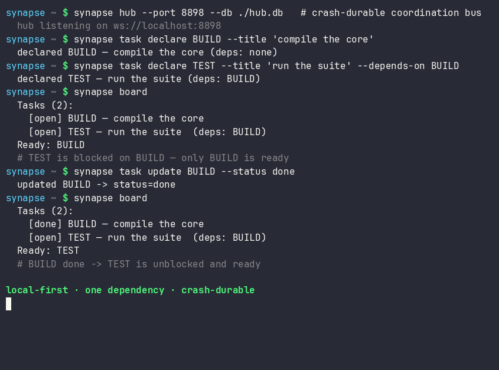

# Quick start

> **Start here.** This page is one path in stages: a 60-second install check,
> connecting a coding agent, then the
> [multi-seat golden path](#multi-seat-golden-path-5-minutes) — the canonical
> "zero to two coordinated agents" walkthrough. If you read one section, read
> that one.

## First 60 seconds

Verify a clean install before connecting real agents:

```bash
python -m pip install synapse-channel
synapse doctor
synapse demo --output ./synapse-golden-demo
```

`synapse doctor` checks identity, hub exposure, local disk pressure,
reachability, and wake-listener setup. It may warn that no hub or waiter is
running on a fresh machine. It also warns when the checked filesystem is nearly
full; pass `--disk-path <path>` to inspect the mount that will hold your Synapse
state, caches, or build artefacts. The installed demo is self-contained: it
starts a temporary local hub and real Git repository, connects Claude and
Codex, gives them separate file claims, deliberately causes an overlapping
claim, proves the mutation guard refuses Codex, atomically hands authority over,
and runs observed verification before releasing with a supported receipt. It
succeeds when it prints:

`CLAUDE` and `CODEX` are scripted in-process `SynapseAgent` identities in this
demo. It launches no provider CLI and spends no model turn.

```text
success: coordination demo completed
```

It also prints the paths to `golden-demo.json` and
`golden-demo-dashboard.html`. Keep those artifacts in a chosen directory with:

```bash
synapse demo --output ./synapse-golden-demo
```

Open the HTML file to see the seven steps, conflict refusal, handoff, and
receipt in the same dashboard projection operators use.

The first-use contract is machine-readable and starts no persistent service:

```bash
synapse commands --profile first-use --json
```

It reports three concepts and three shell commands against an eight-concept
limit, with no optional dependency extra. This is a measurement of the public
journey, not a switch that hides advanced commands.

After the self-contained proof, `synapse quickstart-coding` remains an optional
generated-workspace demo. It creates a temporary workspace, runs the coding-agent
live overlapping-claim refusal demo, removes that workspace after success, and
succeeds when it prints:

```text
success: coding fleet demo completed
```

To inspect the same coding-agent workflow as files you can edit, scaffold a
persistent workspace:

```bash
synapse new coding-fleet ./demo-fleet
cd ./demo-fleet
python run_demo.py
```

That generated workspace succeeds when it prints:

```text
success: coding fleet demo completed
```

## Connect an MCP-capable coding agent

The MCP extra gives an existing host the coordination tools without installing
shell hooks:

```bash
python -m pip install 'synapse-channel[mcp]'
claude mcp add synapse -- synapse mcp
# Codex: codex mcp add synapse -- synapse mcp --name my-repo/codex
```

The short Claude command resolves the git project to `<project>/mcp`. Pin
`--name <project>/<client>` when several clients share a hub. Cursor and Claude
Desktop can reuse the
[`examples/mcp/.mcp.json`](https://github.com/anulum/synapse-channel/blob/main/examples/mcp/.mcp.json)
template.
After the host connects, call `synapse_status` and `synapse_inbox` at the start
of a turn. MCP tool discovery does not wake an idle provider; keep an exact
permanent waiter active with `synapse arm install --identity NAME --start`.
For unattended terminal prompt delivery, also install the active bridge with
`synapse waker install --identity NAME --session SESSION --cwd "$PWD"
--agent-command PROVIDER --start`; systemd owns bridge recovery while the
provider terminal remains untouched.
See [MCP server face](mcp.md) for authentication and client-specific paths.

## Fastest safe trial path

Use one self-contained path before changing a real checkout:

```bash
python -m pip install synapse-channel
synapse doctor
synapse demo --output ./synapse-golden-demo
```

The demo starts and stops its own local hub, uses a disposable committed Git
repository, proves separate claims and overlapping-claim refusal, denies a
mutation before handoff, permits it after handoff, and writes an observed
verification receipt plus a static dashboard. It needs no persistent hub,
provider CLI, Git hook, MCP host, or A2A bridge. The same exact three-command
block is regression-bound across the README, this quick start, and the CLI
reference, and its `synapse demo` command is exercised as a real subprocess.

After that proof passes, use `synapse fleet-init --fix` to prepare a persistent
local workspace, hub, and waiter, then run `synapse git-init --name
trial-agent` inside the real repository before an agent edits it. Optional A2A
interoperability is a follow-on in the [A2A bridge guide](a2a-conformance.md); it is not a
prerequisite for first coordination value.

## Strict exposed-hub profile

The trial commands above are loopback-oriented. Before exposing a hub, supply
every control required by the strict profile; a partial command fails closed:

```bash
synapse hub --paranoid \
  --db ~/synapse/hub.db \
  --token-file ~/.config/synapse/token \
  --message-auth-key-file ~/.config/synapse/message-auth.keys \
  --require-message-auth \
  --acl-policy ~/.config/synapse/acl.json \
  --require-acl \
  --tls-certfile ~/.config/synapse/tls/server.crt \
  --tls-keyfile ~/.config/synapse/tls/server.key
```

Keep token and HMAC entries in owner-only files and replace the ACL and TLS
paths with deployment-specific files. Read [Paranoid mode](paranoid-mode.md)
for the enforced controls, missing hooks, and exposure boundaries.

A complete session — declare a plan with a dependency, complete a task, and watch the
dependent task unblock:



## Launch a team

Bring up a hub plus one or two local model workers in one command:

```bash
synapse team
```

If Ollama isn't running, `synapse team` starts a single offline rule-based
worker (deterministic canned replies) so you can still try the flow end to end;
start Ollama and re-run for real model replies.

## Multi-seat golden path (≈5 minutes)

Run the automated proof first. It uses the same production hub, Git claims,
provider-neutral mutation guard, handoff, release verifier, and dashboard
renderer as a real fleet:

```bash
python -m pip install synapse-channel
synapse doctor
synapse demo --output ./synapse-golden-demo
# open ./synapse-golden-demo/golden-demo-dashboard.html
```

The machine-readable artifact must report `completed: true`, deny the guard
before handoff, allow it after handoff, and carry a `supported` receipt whose
observed commands exited zero. The dashboard must show `SEPARATE CLAIMS`,
`CONFLICT REFUSED`, `MUTATION DENIED`, `HANDOFF`, and `VERIFIED RECEIPT`.

Then apply the same controls to persistent agent terminals. This production
setup ends in the **Studio command centre** — the operator front door for who
is live, what is claimed, and what is at risk.

```bash
# 1. Install + doctor
python -m pip install 'synapse-channel>=0.99.3'
synapse doctor

# 2. Durable token-authenticated loopback hub
#    Add --team-secure only after configuring identity trust, roles and client signing.
mkdir -p ~/synapse
echo "dev-token-$(openssl rand -hex 8)" > ~/synapse/token
chmod 600 ~/synapse/token
synapse hub --port 8876 --db ~/synapse/hub.db --token-file ~/synapse/token &

# Optional multi-seat trust (identity binding + role grants + private directed):
# synapse identity keygen --sender myproj/alice --key-id alice-1 \
#   --private-out alice.pem --trust ~/synapse/trust.json
# synapse role grant myproj/coordinator --to myproj/alice --store ~/synapse/roles.json
# synapse hub --db ~/synapse/hub.db --token-file ~/synapse/token \
#   --team-secure --identity-trust ~/synapse/trust.json --role-grants ~/synapse/roles.json

# 3. For a manual harness, arm a one-shot waiter in each agent terminal
export SYNAPSE_TOKEN=$(cat ~/synapse/token)
syn-wait --directed-only   # background; re-arm after each wake

# For unattended tmux-provider delivery, store only the token-file path:
synapse waker install --identity myproj/alice --session myproj-alice \
  --cwd "$PWD" --agent-command codex --token-file ~/synapse/token --start

# 4. Claim work so the hub refuses overlapping live authority
synapse git-init --name myproj/alice
synapse git-claim BUILD --name myproj/alice --auto-release-on manual \
  --paths src/parser.py
# Continue only after the claim command confirms a grant.

# 5. Open Studio (front door is the command centre)
synapse dashboard --port 8765 --feeds-db ~/synapse/hub.db
# open http://127.0.0.1:8765/  → Studio command centre
# classic hub HTML: http://127.0.0.1:8765/classic
# Optional at-rest: hub --db-key-file + dashboard --feeds-db-key-file (see at-rest-encryption.md)
# Multi-machine fleet fabric uses its own exact released-core pin (see SYNAPSE-CHANNEL-FLEET)

# 6. Close out work with evidence-gated release (default story — not a bare release)
#    Observe checks, write a receipt, then drop the claim you own:
synapse verify-release BUILD --name myproj/alice \
  --run ".venv/bin/python -m pytest tests/test_parser.py -q" \
  --output ~/synapse/receipt-BUILD.json
synapse release BUILD --name myproj/alice \
  --receipt ~/synapse/receipt-BUILD.json --receipt-json
```

Dashboard pages and feeds require a bearer even on loopback. The command prints
the generated bearer when no token or principal policy is supplied. Packaged
Studio pages need an Authorization header; for an ordinary browser unlock form,
follow [the built React cockpit setup](cockpit.md#start-the-cockpit-from-a-source-checkout)
and open `/cockpit/`. Keep the bearer out of URLs.

Success looks like: `synapse who` shows agents and waiters; Studio shows a live
projection and claim segments; a second owner cannot claim overlapping declared scope; a
finished claim leaves a receipt-backed release on the hub (not an evidence-free
drop).

Check multi-seat trust and deaf agents (present without a `-rx` waiter):

```bash
synapse doctor --multi-seat \
  --identity-trust ~/synapse/trust.json \
  --role-grants ~/synapse/roles.json
```

A multi-seat roster without a token/trust/role materials warns with a
`--team-secure` remedy; agents online without waiters warn under `deaf-agents`.

### Evidence-gated release (default closeout)

Prefer **observed** evidence over hand-typed notes when you drop a claim:

1. `synapse verify-release TASK --name YOU --run "…" --output receipt.json` runs
   the declared commands, records exit codes and digests, and writes receipt JSON.
2. `synapse release TASK --name YOU --receipt receipt.json --receipt-json` drops
   **your** claim only when you still own it, attaching the parsed JSON receipt
   on the hub.
3. Optional: `synapse policy-check TASK --policy policy.toml --receipt-json receipt.json`
   for advisory policy evaluation before or after release.

Bare `synapse release TASK --name YOU` still works for emergency manual drops;
the multi-seat default story is verify → receipt → release. Details:
[CLI release / verify-release](cli.md) and the
[parallel-agents recipe](recipes.md#evidence-gated-release-default-closeout).

Receipt evidence is optional unless the configured policy requires it.
`supported` describes the receipt's advisory evidence quality; it does not
establish that the selected checks were sufficient or independently verify an
approval. Resolve an unconfirmed release from its retained operation identity
before retrying.

See [team-secure mode](team-secure.md) and [Studio](studio.md).

## Or run the pieces individually

```bash
synapse hub --port 8876                       # the coordination hub
synapse hub --port 8876 --db ./synapse.db     # replays admitted retained journal state
synapse worker --name FAST --provider ollama --model gemma3:4b
synapse worker --name OFFLINE --provider rule # no network, canned replies
```

For paid provider workers, see the [provider matrix](provider_matrix.md) and
[price evidence and budget setup](provider_pricing.md). Paid calls require a
customer-owned key and explicit local spend controls.

## Talk to the channel

From another terminal:

```bash
synapse listen --name USER                    # terminal A: stream messages as USER
synapse send --target FAST "status of TASK-1?"  # terminal B: one-shot, unique ephemeral sender
synapse board                                 # the shared task/progress plan
synapse manifest                              # advertised agent capabilities
```

## Point the CLI at another hub

Online CLI commands use `ws://localhost:8876` by default. To target a different
hub — a remote coordinator, or a second local hub on another port — set
`SYNAPSE_URI` once instead of repeating `--uri` on each command:

```bash
export SYNAPSE_URI=ws://coordinator.internal:8876
synapse who                                   # now queries the remote hub
synapse send --target FAST "ping"             # another online CLI command
```

An explicit `--uri` on a single command still overrides the environment for that
one call, and unsetting `SYNAPSE_URI` returns to the loopback default.
Offline tools do not contact a hub. The Python client below receives its URI
explicitly; setting the CLI environment variable does not change its
constructor default.

## Coordinate from code

Start a hub in another terminal first — `synapse hub --port 8876` — then connect
to it from your code. Connecting to an already-running hub keeps the example free
of the in-process startup race between binding the server and dialling it:

```python
"""Confirm a claim, checkpoint, status update and release on a local hub."""

import asyncio
from typing import Any
from uuid import uuid4

from synapse_channel import MessageType, SynapseAgent


async def main(*, uri: str = "ws://localhost:8876") -> None:
    """Run each task operation only after the preceding acknowledgement."""
    task_id = "refactor-parser-" + uuid4().hex
    replies: asyncio.Queue[dict[str, Any]] = asyncio.Queue(maxsize=8)
    accepted = (
        MessageType.CLAIM_GRANTED,
        MessageType.CLAIM_DENIED,
        MessageType.CHECKPOINT_SAVED,
        MessageType.CHECKPOINT_DENIED,
        MessageType.TASK_UPDATED,
        MessageType.RELEASE_GRANTED,
        MessageType.RELEASE_DENIED,
        MessageType.ERROR,
    )

    async def receive(frame: dict[str, Any]) -> None:
        """Queue only operation replies for this fresh task."""
        if frame.get("task_id") == task_id and frame.get("type") in accepted:
            replies.put_nowait(frame)

    async def confirmed(expected: str) -> dict[str, Any]:
        """Require the next matched reply to acknowledge the requested verb."""
        frame = await asyncio.wait_for(replies.get(), 5.0)
        if frame.get("type") != expected:
            raise RuntimeError("task operation refused or unexpected reply")
        return frame

    agent = SynapseAgent("ALPHA", receive, uri=uri)
    connection = asyncio.create_task(agent.connect())
    try:
        if not await agent.wait_until_ready(5.0):
            raise TimeoutError("hub registration unconfirmed")
        await agent.claim(task_id, paths=["src/parser"], ttl_seconds=60.0)
        grant = await confirmed(MessageType.CLAIM_GRANTED)
        epoch = grant.get("epoch")
        if grant.get("owner") != agent.name or type(epoch) is not int or epoch <= 0:
            raise RuntimeError("invalid claim grant")
        await agent.save_checkpoint(task_id, "step=2", epoch=epoch)
        saved = await confirmed(MessageType.CHECKPOINT_SAVED)
        version = saved.get("version")
        if type(version) is not int or version <= 0:
            raise RuntimeError("invalid checkpoint acknowledgement")
        await agent.update_task(task_id, status="working", epoch=epoch, expected_version=version)
        await confirmed(MessageType.TASK_UPDATED)
        await agent.release(task_id, epoch=epoch)
        await confirmed(MessageType.RELEASE_GRANTED)
    finally:
        connection.cancel()
        await asyncio.gather(connection, return_exceptions=True)


if __name__ == "__main__":
    asyncio.run(main())
```

The example uses an open loopback hub and legacy literal scope comparison.
Configure token and signing arguments for a protected hub; use the Git-aware
flow above for canonical repository/path identities. Sending a request is not
confirmation: a refusal, disconnect or timeout aborts this sequence, and any
uncertain operation needs read-only reconciliation before retry. A checkpoint
records declared resume state, not a backup of file edits. This example performs
no file edit and attaches no verification evidence; use the
[confirmed edit recipe](recipes.md#the-loop-each-agent-runs) for bounded work
under a granted lease and the observed closeout flow above for receipts.

See the [coordination model](coordination-model.md) for what each verb guarantees.
